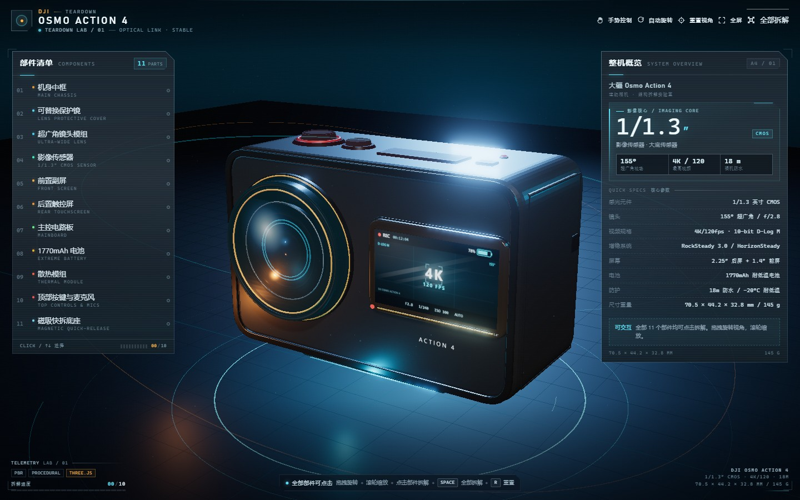

# DJI Osmo Action 4 · 3D 拆解实验室

一个**可交互、支持摄像头手势控制**的 DJI Osmo Action 4 程序化 3D 拆解可视化页面。核心场景只使用 Three.js / HTML / CSS / JavaScript，所有 3D 几何与屏幕纹理均由代码生成，不含外部 3D 模型。



**在线演示（含摄像头手势识别）：** https://aimiliya825.github.io/deepseek_project/

> 如果 GitHub 仓库页面只显示 README，请点击上面的在线演示链接；手势识别需要通过 HTTPS 或 localhost 打开。

## 快速开始

- **只看 3D / 鼠标浏览**：直接双击根目录的 **`index.html`**。
- **使用摄像头手势拆解**：请使用上面的 GitHub Pages 在线演示，或在项目目录启动本地 HTTP 服务：

```powershell
python -m http.server 8123
# open http://localhost:8123
```

> 手势识别需要安全上下文（HTTPS / localhost）。页面核心约 2.7 MB；MediaPipe 手势运行库与模型（约 25 MB）只在点击“手势控制”后按需从同仓库加载，不会上传摄像头画面。

## 核心能力

- **11 个可拆解部件**：机身中框、可替换保护镜、155° 超广角镜头、1/1.3″ CMOS 传感器、前置副屏、后置触控屏、主控板、1770mAh 电池、散热模组、顶部按键与麦克风、磁吸快拆底座。
- **摄像头手势拆解（新增）**：点击右上角「手势控制」或按 `G`，举起手掌移动光标，捏合抓住部件，上下拉动手掌完成拆解/推回；捏合机身中框可全部拆解/组装。所有手部画面仅在本地识别，不上传。
- **点击拆解**：未开启手势模式时，点击 3D 部件或左侧清单即可触发该部件沿设计方向分离/复位；支持一键全部拆解与全部组装。手势模式中鼠标点击仅选择部件，不会触发拆解。
- **自由观察**：拖拽旋转、滚轮缩放、右键/双指平移，自动旋转可在顶部开关；重置视角一键回到展示机位。
- **部件详情**：右侧面板显示部件类别、中英文名称、结构说明与真实参数；左侧进度与部件状态同步更新。
- **发光标注**：拆解后每个部件都有投影标注卡与引导线（名称 + 关键参数），选中部件有青色高亮、发光轮廓与 3D 锁定环。
- **科技氛围**：深色空间、程序化影棚环境反射、体积感地面网格、扫描弧线、浮尘粒子、UnrealBloom 辉光与雾气。
- **操作引导**：首屏引导卡 + 底部快捷键提示；支持键盘 `Space`（全部拆解/组装）、`R`（重置视角）、`Esc`（取消选中）、`A`（自动旋转）、`G`（开关手势控制）。手势面板内置四步操作说明。
- **响应式与无障碍**：桌面双栏 HUD、平板紧凑布局、手机底部抽屉面板；完整按钮/ARIA/焦点环；尊重 `prefers-reduced-motion`。

## 操作提示

| 操作 | 效果 |
| --- | --- |
| 拖拽 / 单指拖动 | 旋转视角 |
| 滚轮 / 双指捏合 | 缩放 |
| 右键拖拽 / 双指拖动 | 平移 |
| 点击部件或清单行 | 选中并拆解 / 查看参数 |
| 再次点击已拆部件 | 组装复位该部件 |
| `Space` | 全部拆解 / 全部组装 |
| `R` | 重置视角 |
| `Esc` | 取消选中 |
| `A` | 开关自动旋转 |
| `G` | 开启 / 关闭摄像头手势控制 |

## 摄像头手势操作

1. 点击右上角 **手势控制**（或按 `G`），允许浏览器使用摄像头。
2. **移动手掌**：手势光标跟随手掌移动，悬停到部件上会高亮并显示部件名称。
3. **捏合**（拇指与食指靠近）：抓住当前部件；保持捏合并 **上下移动手掌**，即可把部件逐段拉出或推回。
4. **捏合机身中框**：在全部拆解 / 全部组装之间切换。
5. 松开捏合后，部件会自动吸附到“已拆解”或“已复位”的稳定状态。

> 建议在光线充足、背景简洁的环境使用；摄像头画面只在浏览器本地交给 MediaPipe 识别，不会上传。

## 实现说明

- **完全程序化**：所有壳体、圆形镜头、旋钮齿纹、屏幕、PCB、芯片、铜均热板、铝鳍片、磁吸底座均由 `THREE.BufferGeometry` / Extrude / Lathe 等代码生成；屏幕 UI 与品牌字标由 `CanvasTexture` 实时绘制。
- **本地 Three.js**：`vendor/three.bundle.js` 由本地 Three.js r186 源码与所需 addons（OrbitControls、EffectComposer、UnrealBloomPass、OutputPass）打包为经典脚本，最终内联进 `index.html`，因此双击文件即可运行。
- **画面管线**：PBR 材质 + 程序化 CubeTexture 环境 + 定向主光/青橙轮廓光 + PCF 软阴影 + HDR Bloom + ACES 色调映射。
- **摄像头手势**：MediaPipe Tasks Vision + Hand Landmarker（本地托管），21 个手部关键点识别手掌位置、捏合距离和开合状态；手势光标与 3D 部件拾取、拆解进度实时联动。
- **交互状态机**：拆解位移、相机自动取景（按屏幕安全区计算投影包围盒与最佳距离）、发光强度、部件标签位置均由同一动画循环驱动。
- **混合交付**：`tools/build_page.py` 将 CSS、Three bundle、数据、模型、UI、交互脚本内联为一个 `index.html`；手势运行库作为可选资源放在 `vendor/mediapipe/`，仅在开启摄像头时加载。

## 目录结构

```
index.html                  单文件最终交付页（离线可用）
src/
  template.html             页面壳与启动画面
  parts-data.js             11 个部件的数据、参数、拆解方向、强调色
  model.js                  纯代码生成的 Action 4 3D 模型
  ui.js                     全部 HUD 面板、清单、详情、引导与移动端交互
  ui.css                    HUD 视觉样式
  app.js                     Three.js 场景、灯光、辉光、拆解动画、标签、拾取
  app.css                   场景容器、投影标签、启动画面、背景氛围
  gesture.js                 摄像头手势控制器（MediaPipe Hand Landmarker）
  gesture.css                手势面板、相机预览、手掌光标样式
vendor/                     Three.js r186 打包源码与产物
vendor/mediapipe/           可选：MediaPipe Tasks Vision + Hand Landmarker 模型
tools/                      构建、几何投影、Node 集成测试、headless 渲染验证
docs/CONTRACT.md            各模块接口与团队协作契约
tests/                      模型与 UI 的独立预览页
```

## 构建与验证

```powershell
# 重建单文件页面（已内联所有内容）
python tools/build_page.py

# 仅构建 Three.js 经典脚本 bundle
python tools/build_three_bundle.py

# Node 集成校验（无浏览器依赖）
node tools/test_model_node.js
node tools/test_app_node.js
```

> 注：内嵌材质/参数基于 DJI Osmo Action 4 公开规格进行可视化还原；内部堆叠、散热模组与部分结构件为拆解展示用途的合理建模。

## 更新记录

- 修复 `MeshBasicMaterial` 上误挂 `emissive` 字段导致 WebGL 每帧渲染抛出 uniform 异常、3D 模型不可见的问题；已加入模型回归测试。
- 调整环境反射、曝光与 Bloom 强度，避免机身顶部高光过曝。
- 增加真实浏览器（headless Edge）截图与渲染验证。
- 新增摄像头手势控制：手掌移动光标、捏合抓取、上下拉动拆解、捏合中框全拆/全装；相机画面仅本地处理。
- 手势模式使用真实 MediaPipe Hand Landmarker，已通过 fake-webcam 手部检测与 headless 渲染验证。

## 技术约束

- 仅使用 Three.js、HTML、CSS、JavaScript；无框架、无外部 3D 模型、无外部贴图/字体。
- 所有 UI 与 3D 元素均不发起网络请求；直接在 `file://` 下打开即可。
